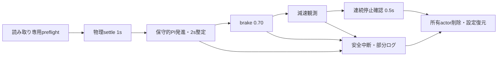

# 単車制動校正 Harness（初回1.0m/s）

Issue #18。PR #17を実装baseとする、TM追従から独立した校正器。**実CARLA未検証。配布設定のroute_auditはnullで、実走は接続前に拒否する。新たな明示承認なしに実走しない。** 本書の制御gain・距離仮定は暫定設計値で、物理性能の実証値ではない。

## 背景と再利用

既存Stage1はTesla Model3のAPI縦加速度約17.32m/s²を観測し、brake0.70が初めて現れたframeで終了した。brake後の減速frameがなく、b=2m/s²や応答0.3sは未実証。Town10HD_Optの同一road/sectionで200mを確保することもできない。単車・低速の独立試験で観測を整える。

- `idm_experiment_harness.Harness` の唯一のtick関数、frame/time検査、台帳、raw観測、異常分類、所有actor削除・WorldSettings復元を再利用。
- 読み取り専用の `inspect_world_route(strict=True)` を共通化。通常のfollowingでの検査順序・TM設定・設定形式は維持。
- Cleanupにkeyword `manage_tm=True`（従来既定）を追加。単車だけFalseで呼び、TMを生成・登録・seed設定・同期変更しない。
- 監視親 `supervise()` に省略可能な `entrypoint/source_files/verify_completed` を追加。従来の入口は既定動作のまま。校正workerの終了後に親がサーバ不要で成果物を検査し、不完全なら `invalid_result` とする。
- `HealthGate`、OS listener/PID確認、共有exclusive lease、halt marker、native exit/fatal stderr監視を再利用。親はCARLAをimportせず、native終了後にもRPCを行わない。

IDM式・T推定・traits・V1/V2の入出力形式は変更しない。校正用出力は独立したschemaで、following履歴やT推定の入力に流用しない。

## 実験構成と制御責任

CARLA0.9.16 / Town10HD_Opt / vehicle.tesla.model3を1台、dt0.05s、physics substep0.01s/10。新規所有actorに対してだけVehicleControlを発行する。TM API・Autopilot API・set_target_velocity・teleportは呼ばない。新規actor生成とAPI台帳の「登録未要求」を根拠として記録し、存在しないAutopilot getterで登録状態を確認したとは言わない。



- 発進は絶対速度誤差のPI（P=.08、I=.03）＋anti-windup。throttle上限0.10、slew上限0.10/s（0.05sごと最大0.005）。TMのPIDやIDM式ではない。積分は飽和時に増やさない。
- 舵は経路heading誤差・符号付き横偏差からP制御（.05/degreeと.2/m）、絶対上限0.10。これらも未校正gainで、mock成功を実車両の制御成立と扱わない。
- 発進中のbrake要求は0。目標1.0m/sに対し±0.1m/s、|a_long|<=0.5、|vz|<0.05が連続2s（41snapshot）必要。最大5s/移動6mで成立しなければ中止し、自動でgainや上限を増やさない。
- 整定した観測frameを基準にbrake遷移を台帳に記録。throttle0 / brake0.70 / hand_brake falseを保持しながら舵を更新する。各制御requestは次tick前に発行し、毎frameの命令と実controlを別々に記録する。
- 速度<0.05m/s、|v_long|<0.05、|vz|<0.05、|a_long|<=0.5、実brake一致が連続0.5s（11snapshot）になるまで観測する。途中で再動すれば確認窓をリセット。brakeの初観測だけでは終了しない。

## 安全gate・終了分類

全phaseでAPIの3D accelerationを車体forwardへ射影し、|a_long|>5m/s²を1frame、>3を2frame連続で中止。加速度unknown/非有限値も中止。5はgateであり、物理的な加速度上限ではない。

速度上限1.2m/sは `max(水平速度ノルム, |車体前方速度|)` に適用する。物理settle中の落下を走行速度と混同しないための独立校正用定義で、3D速度・vzも記録する。ready/stopにはvz条件も必要。

以下も中止する：逆向き運動、hand_brake/reverse/manual gear、実throttle/steer上限超過、制御unknown、試験前の予期しないbrake、lane/junction変更、横偏差>0.3m・heading/pitch/roll>5度、bboxの車線外、前端余裕20m未満、信号影響/不明、actor消失/外部actor出現、WorldSettings変更、frame/time不整合、RPC/server異常。

brake遷移後0.3sまでに (a)brake0.70の実control観測、(b)速度低下0.02m/s以上かつa_long<=-0.2を2frame連続で観測、の両方がなければ安全中止。0.3sは**採否を判定する期限**で、既知の応答性能ではない。brakeを一度観測した後に入力が失われれば中止。制動観測は最大5s、連続停止がなければ中止する。強い制動自体が加速度gateに抵触した場合も緩和せず中止し、停止距離の完全測定として採用しない。

- `completed` / exit0：連続停止・成果物整合・cleanupを確認したデータ取得完了。性能下限を認定した意味ではない。
- `safe_early_stop` / 2：安全中断、censored・無効。
- `exception` / 1、`server_unavailable` / 4、`cleanup_incomplete` / 5、`native_abnormal_exit` / 3、`worker_timeout` / 6を区別。
- 親の終了後検査に失敗すれば `invalid_result` / 1。workerのexit0だけを信用しない。
- server/RPC異常でHealthGateがpoisonしたら追加RPC・retry・cleanup RPCを禁止。設定やactorの残存は未確認として記録する。workerはC++ destructorを避けて終了し、親も復旧RPCを送らない。
- 観測・集計・cleanupは追加tickを発行しない。既存証跡ディレクトリは再利用しない。

## 56m区間と距離予算

候補はroad10/section0/lane1、s120→64。同一key・s減少・整数1m刻み。過去の保存地図では幾何を調べられるが、単車校正の実scene・路面・障害物監査を完了したとは扱わない。

探索的stressとしてv1.2、遅延0.5、遅延中加速5、制動0.5を仮定すると、`v*tau+a*tau²/2+(v+a*tau)²/(2*b)=14.915m`。発進6＋前端2.42511＋停止14.915＋停止後余裕20＝43.34011m、56mなら12.65989m余る。CLIとdistance_budget.jsonに出力する。b0.5/tau0.5/a5は未測定の探索仮定で、braking_lower_bound/response_upper_boundへ記入しない。無制動や想定外加速まで安全保証する値でもない。

実行にはconfigの `route_audit` が必要：policy_sha256、opendrive_sha256、evidence_sha256、map_name、carla_version、reviewed_by、reviewed_at、evidence_reference、scene_review_reference、dedicated_session_reference、points（全57点のx/y/z）。物理boundはnull/未記入でなければ拒否する。レビュー欄を形式的に埋めず、参照証跡の実物とhashを人手で照合する。

起動前検査はversion/map、元WorldSettings（既存sync worldは拒否）、既存vehicle/walker/sensor/controllerがないこと、OpenDRIVE hash、全route geometry、Driving/幅3.4m以上・非junction・単一接続・全体yaw差0.5度以下・標高差0.02m以下/点・規制landmark・静的路上車両bboxを照合し、不一致なら設定変更・spawn前に拒否する。spawn後には実blueprint/bboxとphysicsパラメータを読み、mass/4輪のradius/friction/max brake torqueが不明ならtick前に中止。

OpenDRIVE・車両bbox検査だけでは道路メッシュ・全障害物・摩擦材を網羅できない。専用collision sensorは導入していない。これらは人手の実scene監査が残る。route_auditの自己申告だけで安全を証明しない。現在の配布JSONはnullのままで実走不可。

## 記録と評価

- config_used / launch / environment / vehicle_physics：設定fingerprint、Git commit/dirty/source hash、元/適用WorldSettings、初期/所有actor、TM未使用、車両physics/車輪設定・天候を保存。取得できないsurface material/RPM等はnull。
- command_ledger：命令sequence・基準frame・sim時刻・wall時刻・control値、requested/call_returned/failed。call_returnedは入力の観測一致を意味しない。
- calibration_observations.csv：全tickのframe/world time、pose/forward/velocity XYZ、3D/水平/前方速度、API/速度差分縦加速度・差、実control/gear、route情報、現在命令・最初のbrake命令基準frame/time/progress/speed。
- calibration_raw.jsonl / last_observation.json：同frameのrawと命令。最初にpartial envelopeを保存し、取得途中の例外でも現在frameと取得済み位置/速度を残す。completeかつframe再照合後だけvalidatedにする。semantic異常のrawを先に保全する。
- calibration_metrics.json / worker_result / result：命令→実control・命令→減速のframe差と観測秒数、control→減速frame差、停止開始/確認frame、命令基準/実control観測基準の距離、停止時間、最小/最大加速度、制動中の全時系列・平均/min/max/時間方向の母標準偏差、API/差分の差の統計、valid/censored/異常理由。

停止距離はbbox中心を経路へ投影したprogressの差。実control基準は最初にget_controlで観測したsnapshot位置であり、engine入力反映の厳密な瞬間位置ではない。閾値による停止開始時刻と0.5s確認完了時刻を別に報告し、数学的な速度ゼロと同一視しない。標本化は50ms、減速開始確認は2点必要。これらを遅延の実証上限とは呼ばない。

API加速度と速度差分は共通の速度情報を用いるため、比較は独立センサ検証ではない。1試行の標準偏差は時間変化であり、試行間ばらつきや保証区間ではない。物理boundは成功時にもnullのまま。1m/s・手動brakeの結果を5m/sやTM PIDへ外挿しない。

## 初回試験の手順（今回実行しない）

1. 現在のserver PID/開始時刻・正常応答・0.9.16/map・専用session・他client/tick owner不在を新たに確認する。以前のPIDを流用しない。監視親の共有leaseは協調client向けで、全外部client不在の証明にはならない。8000のTM listenerがあればこの校正入口は拒否する（TMへのRPCは送らない）。
2. 56mの単車用scene/路面/規制/障害物・配置/距離をレビューし、ローカルの新configへ監査証跡を設定する。物理性能の実測値を先に埋めない。現worldとの一致は起動時にも再検査する。
3. CARLAなしで設定を検証し、fingerprint・Git commit・出力先を確認する。

```powershell
python dt_risk_prediction_project/Run_Calibrate_Brakes.py --config <ローカル監査済みJSON>
```

4. 新たな明示的承認後だけ、正式入口で1回実行する。設定緩和や自動再試験をしない。

```powershell
python dt_risk_prediction_project/Run_Calibrate_Brakes.py --config <ローカル監査済みJSON> --execute --server-pid <現在PID> --output-root <新規証跡親ディレクトリ>
```

5. 終了分類・stderr・final frame・cleanup/設定復元を監査する。完了runだけ次で読み取り専用再評価する。不完全/unsupervised・raw/CSV/ledger/frame不整合・安全条件違反は拒否する。

```powershell
python dt_risk_prediction_project/Run_Calibrate_Brakes.py --evaluate-run <runディレクトリ>
```

## 後続の校正計画

初回は観測と状態遷移の成立確認。条件固定の反復で再現性・試行間ばらつきを評価した後、十分な道路を監査して2/4/5m/s域を個別レビューする。車種/physics/路面/gear/制動入力を固定・記録し、速度域ごとに停止距離と遅延を評価する。次に単車TM閉ループの速度要求→PID入力→実control→運動を別試験で確認する。静止TM発進も別途加速度gateを満たす必要がある。Stage2/T推定/未来予測比較には自動移行しない。

## CARLA 0.9.16の参照

- [VehicleControl / VehiclePhysicsControl](https://github.com/carla-simulator/carla/blob/0.9.16/PythonAPI/docs/control.yml)：brakeは0〜1の無次元入力。mass・車輪摩擦・最大brake torque等は車両physicsの設定で、入力値から一定減速度を保証しない。
- [DefaultMovementComponent.cpp](https://github.com/carla-simulator/carla/blob/0.9.16/Unreal/CarlaUE4/Plugins/Carla/Source/Carla/Vehicle/MovementComponents/DefaultMovementComponent.cpp)：VehicleControlをmovement componentへ渡す経路。
- [WorldObserver.cpp](https://github.com/carla-simulator/carla/blob/0.9.16/Unreal/CarlaUE4/Plugins/Carla/Source/Carla/Sensor/WorldObserver.cpp)：snapshot加速度の速度差分による計算。
